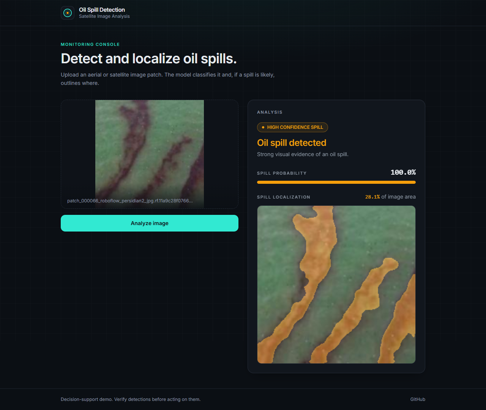
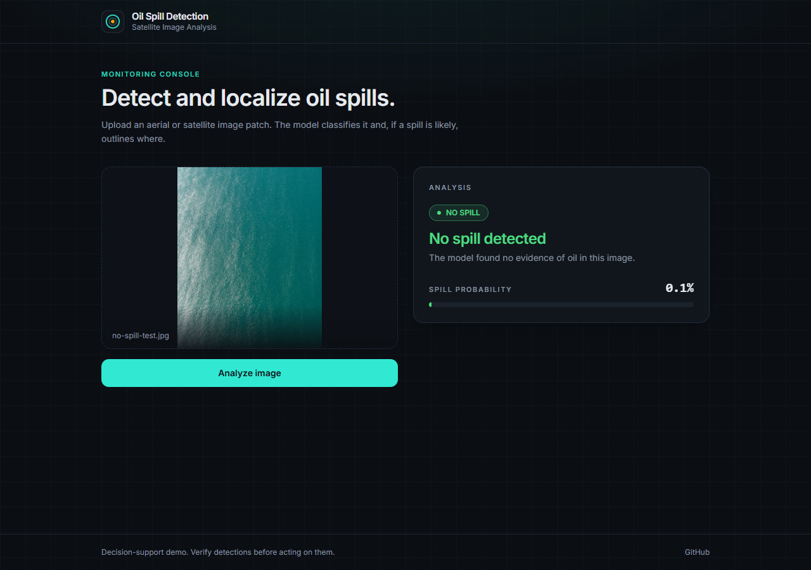

# Oil Spill Detection System

A deep learning project for industrial oil spill detection using satellite/aerial imagery. This system provides both **Classification** (detecting if a patch contains oil) and **Segmentation** (pixel-level masking of the spill).

## Features
- **Binary Classification**: Robustly differentiates oil spills from clean ocean textures using MobileNetV3-Large.
- **Hard Negative Sampling**: Specifically trained on challenging ocean textures like wave foam and coastlines.
- **3-Zone Labeling**: Clean supervision logic that eliminates ambiguous samples during training.
- **Semantic Segmentation**: Pixel-level spill delineation using U-Net with ResNet34 backbone.
- **Threshold-Based Inference**: A single spill threshold (0.25) decides spill vs. no spill and triggers segmentation; a separate high-confidence band (0.5) only changes the displayed confidence label.

## Demo

Upload an aerial or satellite image patch — the model classifies it, and if a spill looks likely, segments and highlights exactly where.

### Spill detected



Input: `docs/demo-images/spill-test.png` (test set sample)

### No spill



Input: `docs/demo-images/no-spill-test.jpg`

<sub>Photo via [Unsplash](https://unsplash.com)</sub>

## Project Structure
```text
project_root/
├── src/
│   ├── data/       # Data preparation & split scripts
│   ├── models/     # Model architectures
│   ├── training/   # Model training pipelines
│   ├── inference/  # Prediction & web UI tools
│   └── tools/      # Evaluation & error analysis tools
├── scripts/        # Utility & download scripts
├── data/           # (Ignored) Raw datasets & generated splits
├── models/         # (Ignored) Trained .pth checkpoints
├── outputs/        # Metrics & visualizations (per-epoch prediction CSVs are ignored)
├── requirements.txt
└── README.md
```

## Results

| Task | Metric | Validation | Test |
|---|---|---|---|
| Classification | Accuracy | 92.51% (best epoch) | 92.79% |
| Classification | F1-Score | 0.9266 (best epoch) | 0.9285 |
| Segmentation | Dice | 0.8899 (best epoch) | 90.09% |
| Segmentation | IoU | - | 83.88% |

Training curves, confusion matrix, and segmentation prediction samples are available in `outputs/classification/` and `outputs/segmentation/`.

## Data

This project uses two datasets, neither of which is included in this repository (see `.gitignore`). Both must be downloaded and placed manually before running the data pipeline.

### LADOS
Gkountakos, K.; Melitou, M.; Ioannidis, K.; Demestichas, K.; Vrochidis, S.; Kompatsiaris, I.
"LADOS: Aerial Imagery Dataset for Oil Spill Detection, Classification, and Localization Using Semantic Segmentation."
*Data* 2025, 10(7), 117. https://doi.org/10.3390/data10070117

Dataset: https://universe.roboflow.com/konstantinos-gkountakos/lados
Place downloaded files under `data/raw/lados/`.

### Roboflow Oil Spill Dataset
"Oil Spill detection" dataset by mon, Roboflow Universe, 2024.
https://universe.roboflow.com/mon-ehjb6/oil-spill-detection-gajxc
License: CC BY 4.0
Place downloaded files under `data/raw/roboflow/`.

After placing both datasets, run the build scripts described in Setup to generate the processed splits.

## Setup
> **Requirement**: Python 3.10+ is required (tested on Python 3.12).

1. Clone the repository
2. Install dependencies:
   ```bash
   pip install -r requirements.txt
   ```
3. Download pretrained model weights:
   ```bash
   python scripts/download_weights.py
   ```
4. Obtain raw datasets per the Data section above, and place them under `data/raw/`
5. Run the data build scripts to generate processed splits:
   ```bash
   python src/data/build_segmentation.py
   python src/data/build_classification.py
   ```
6. Train models or run inference:
   ```bash
   # Train classification and segmentation models from scratch
   python src/training/train_classification.py
   python src/training/train_segmentation.py

   # Single image CLI prediction
   python src/inference/predict.py --image path/to/image.png --mode dual

   # Launch interactive Gradio Web UI
   python src/inference/app.py
   ```

## API

A FastAPI service wraps the inference code (models load once at startup). Run from the project root:

```bash
uvicorn src.api.main:app --host 127.0.0.1 --port 8000
```

Interactive docs are served at http://127.0.0.1:8000/docs. The Gradio app uses port 7861, so the two don't collide.

| Endpoint | Description |
|---|---|
| `GET /` | API name, version and docs link |
| `GET /health` | `{"status": "ok", "models_loaded": true}` |
| `POST /predict` | multipart upload (`file`); returns `probability`, `binary_label`, `confidence_label`, `spill_detected`, `segmentation_status`, and, when a spill is predicted, `overlay_png_base64` and `area_percentage` |

```bash
curl -X POST http://127.0.0.1:8000/predict -F "file=@path/to/image.png"
```

Errors are JSON `{"detail": "..."}`: `400` for a missing/corrupt image, `413` for files over 20 MB, `500` for inference failures. CORS currently allows all origins and there is no authentication.

## Frontend

A React demo UI (Vite + TypeScript + Tailwind) lives in `frontend/` and calls the API above. With the backend running, in a second terminal:

```bash
cd frontend
npm install
cp .env.example .env   # sets VITE_API_URL (default http://localhost:8000)
npm run dev
```

Open http://localhost:5173.

## Evaluation
- Detailed metrics (IoU, Dice, F1, Recall) are exported to `outputs/` after training.
- Error analysis and visualization tools are available:
  ```bash
  python src/tools/analyze_errors.py --csv outputs/classification/val_predictions_epoch_1.csv
  python src/tools/evaluate_thresholds.py --csv outputs/classification/val_predictions_epoch_1.csv
  python src/tools/visualize_classification.py --csv outputs/classification/val_predictions_epoch_1.csv
  ```

## Citation

If you use this project, please consider citing the datasets it depends on:

```bibtex
@article{gkountakos2025lados,
  title={LADOS: Aerial Imagery Dataset for Oil Spill Detection, Classification, and Localization Using Semantic Segmentation},
  author={Gkountakos, Konstantinos and Melitou, Maria and Ioannidis, Konstantinos and Demestichas, Konstantinos and Vrochidis, Stefanos and Kompatsiaris, Ioannis},
  journal={Data},
  volume={10},
  number={7},
  pages={117},
  year={2025},
  publisher={MDPI},
  doi={10.3390/data10070117}
}

@misc{oil-spill-detection-gajxc_dataset,
  title = {Oil Spill detection Dataset},
  type = {Open Source Dataset},
  author = {mon},
  howpublished = {\url{https://universe.roboflow.com/mon-ehjb6/oil-spill-detection-gajxc}},
  url = {https://universe.roboflow.com/mon-ehjb6/oil-spill-detection-gajxc},
  journal = {Roboflow Universe},
  publisher = {Roboflow},
  year = {2024},
  month = {mar}
}
```

## Licenses & Attribution

**Code**: MIT License (see [LICENSE](LICENSE)).

**Model weights**: the trained weights are derived from the datasets below and are made available for research and non-commercial use. If you plan to use them commercially, check the licensing terms of the underlying datasets and the ImageNet-pretrained backbones used during training.

**Training data**:
- **LADOS** — Gkountakos, K.; Melitou, M.; Ioannidis, K.; Demestichas, K.; Vrochidis, S.; Kompatsiaris, I. "LADOS: Aerial Imagery Dataset for Oil Spill Detection, Classification, and Localization Using Semantic Segmentation." *Data* 2025, 10(7), 117. https://doi.org/10.3390/data10070117 — licensed CC BY 4.0.
- **Roboflow "Oil Spill Detection" dataset** — licensed CC BY 4.0.

**Demo image**: the "no spill" demo photo is sourced from [Unsplash](https://unsplash.com).
